# professor-contact

`professor-contact` 是 ScholarWorkflow 的套磁编排与状态机仓库，负责从用户选中的教授研究方向，一路生成可追溯的研究想法、用户选择状态与首封/跟进邮件。

当前仓库同时面向 `opencode` 与 `codex`；两个 runtime 的委派方式不同，但共享同一套 Stage 0–5 业务状态与机器事实源。

## 安装

### 使用 Skills CLI 安装套磁工作流技能

需要 Node.js `>=22.20.0` 和 npm。在仓库根目录运行：

```sh
npm install
npm run skills:install
```

`package.json` 将 Skills CLI 固定为 `1.7.2`，安装命令使用该版本支持的 `skills experimental_sync`。清单包含 67 个不重复技能：六个工作流入口 `professor-contact`、`professor-collector`、`professor-topic-clustering`、`paper-analysis`、`humanizer-ja`、`vision-tools`，以及它们正常调用的 Zotero 读写/分类/打标、摘要抓取、Sci-Hub、搜索和浏览器下载依赖。浏览器下载清单含 `browser-pdf-core`、`browser-pdf-download`、`chrome-devtools` 和上游当前的 50 个出版社下载适配技能；`sd-download` 是已合并的旧适配器，不再使用。完整清单以 `package.json` 的 `skills` 字段为准，按上游仓库分组，避免同名技能重复覆盖。

每个来源指向相应仓库的 `.apm/skills` 目录；Skills CLI 只安装列出的技能目录及目录内的 `SKILL.md`、脚本和相对资源，不会自动复制目录外的共享文件。来源跟随清单指定的 GitHub 分支：`paper-analysis`、`zotero-tools` 和 `source-access-skills` 使用 `master`，其他来源使用 `main`。`source-access-skills` 是私有仓库，安装者需要已有 GitHub 访问权限；安装时获取所选分支的最新内容。

此入口不递归读取 `apm.yml`，也不安装 `.apm/agents`、MCP 配置、其他 APM 包或运行时工具包。`professor-contact` 的阶段流程需要配套的自定义代理和 MCP；例如 `professor-contact-style-validator` 是代理，不是 skill。要安装完整运行环境，请使用下方的 APM 方式。

### 使用 APM 安装完整项目依赖

原有 APM 安装方式继续可用：在仓库根目录运行 `apm install`。依赖与目标仍由根目录的 `apm.yml` 声明；需要 OpenCode/Codex agent、MCP 配置或其他 APM 包时，使用这条路径。

### 使用 Nix 安装（aarch64-darwin / Codex）

仓库新增 Nix 交付入口，只面向 `aarch64-darwin` 与 Codex；Linux 与 OpenCode 仍用上面的 Skills CLI 或 APM 方式。它把完整 skill、八个原生角色、Stage 5 路由附录与七个固定运行入口装进一个消费者项目，业务正文仍以 `.apm/` 源为唯一来源，不在 `nix/` 保存第二份。

```sh
RUN=$(mktemp -d /tmp/contact-nix.XXXXXX); CONSUMER="$RUN/consumer"; mkdir -p "$CONSUMER"
nix build "$CONTACT_REF#professor-contact-runtime" --out-link "$RUN/runtime"
nix build "$CONTACT_REF#professor-contact" --out-link "$RUN/package"
nix build "$CONTACT_REF#professor-contact-environment" --out-link "$RUN/environment"
"$RUN/environment/bin/agent-env" apply --project "$CONSUMER"
```

`CONTACT_REF` 是本仓库的实际提交，例如 `github:ScholarWorkflow/professor-contact/<40 位 SHA>`；不要用开发 checkout 的路径输入代替。固定输出：

| 输出 | 内容 |
| --- | --- |
| `packages.aarch64-darwin.professor-contact-runtime` | 固定解释器的完整自有资源（`scripts/`、`docs/`、`tests/`、隐藏辅助文件），普通 derivation，不冒充 agent 安装 |
| `packages.aarch64-darwin.professor-contact` | `id = "professor-contact"` 的 agent 包，默认 `enableHarnesses = [ "codex" ]`；`professor-contact.override { enableHarnesses = []; }` 可按包关闭投影 |
| `packages.aarch64-darwin.professor-contact-environment` | `mkProject` 环境，`roots = [ professor-contact ]`，提供 `bin/agent-env`，下游可与其他顶层包组合 |
| `packages.aarch64-darwin.professor-contact-activate` | 固定 `bin/professor-contact-activate` 入口，按 environment store 路径与项目物理路径缓存成功安装 |

#### direnv / devShell 自动激活

此入口正在等待 [agent-env-nix #4](https://github.com/RekiDunois/agent-env-nix/pull/4) 合并。当前保留已发布的 `agent-env-nix` pin；它尚不导出 `lib.mkCachedActivation`，因此求值/构建 `professor-contact-activate` 会明确报等待错误，不应把本 PR 当成已可消费版本。上游合并后再固定包含该接口的真实合并后提交并更新对应 lock；不临时锁定未合并分支。现有 environment/runtime/package 输出不受此等待影响。

接线直接调用上游 `lib.mkCachedActivation { pkgs; environment = products.project; name = "professor-contact-activate"; }`；本仓库不再维护重复的包装脚本与行为测试。完成上述 pin 后，已有 direnv 的消费者可以把下面的 `flake.nix` 放在自己的项目根目录，`.envrc` 使用 `use flake`。消费者只调用固定 store 入口，不需要复制脚本。示例中的 contact main 也须已包含本功能。

```nix
{
  inputs = {
    contact.url = "github:ScholarWorkflow/professor-contact/main";
    nixpkgs.follows = "contact/nixpkgs";
  };

  outputs = { contact, nixpkgs, ... }:
    let
      system = "aarch64-darwin";
      pkgs = nixpkgs.legacyPackages.${system};
      activate = contact.packages.${system}.professor-contact-activate;
    in {
      devShells.${system}.default = pkgs.mkShell {
        packages = [ activate ];
        shellHook = ''
          "${activate}/bin/professor-contact-activate" --project "$PWD" || exit $?
        '';
      };
    };
}
```

`main` 由消费者的 `flake.lock` 锁定，更新 input 后才会取新版本。入口默认使用当前目录，也接受 `--project DIRECTORY`。它用 environment 的 store 输出路径和项目的物理路径（`pwd -P`）记录成功：首次、environment 变化或项目移动后调用原有 `agent-env apply --project`；同版本同路径只检查成功标记，不扫描/复制技能。该缓存不验证安装文件是否仍然完整；手动删除或修改安装产物后，在 devShell 中运行 `professor-contact-activate --force` 重新 apply（仍遵守共享安装器的保护规则）。

项目根目录的 `.agent-env-applied` 是本入口的成功标记，只有 apply 成功才原子写入；再次 apply 前删除旧标记，所以失败后下次会重试。标记若是符号链接或非普通文件会报错。请在消费者的 `.gitignore` 加入 `/.agent-env-applied` 和 `/.agent-env-apply.lock/`，不要提交或手动伪造标记。

同一项目通过 `.agent-env-apply.lock` 串行激活；并发调用会立即报错，请待前一次结束后重试。正常退出会清锁；若进程被强杀或机器崩溃，确认没有激活进程后才手动删除遗留锁目录。直接调用原有 `agent-env apply/remove` 不参与这个锁，也不会更新成功标记；不要与本入口并发运行，之后再次使用缓存入口前应使用 `--force` 重建成功状态。路径含换行符不支持。以上仅新增缓存包装层，不改变原有 environment 接口或 APM 安装。

共享 marker/锁按项目而非命令名区分；同一项目需要多个 root 时，应先组合为一个 `mkProject` environment，再包装一次。不要逐个激活独立 environment 来累加技能，它们会相互替换。旧 contact 专用 `.professor-contact-applied` 不作为共享缓存成功证据；升级后第一次重新 apply 是预期行为，不复制或改名旧 marker 来跳过安装。旧入口与新入口的锁名不同，也不得并发运行。

通用缓存行为由 agent-env-nix 的共享测试负责；本仓库只核对接线与消费边界。当前实施及验证范围见 [执行计划](plan/cached-nix-activation/implementation-plan.md) 和 [测试计划](plan/cached-nix-activation/test-plan.md)。旧产品的 Darwin/direnv 已执行记录保留，不能作为本次新共享接线通过的证明。

依赖按上游实际发布提交固定：`agent-env-nix` 固定共享安装器，`paper-analysis`、`zotero-tools`、`base-skills`（`humanizer-ja`、`vision-tools`）、`pdf-processing-core`（`pdfx-agent` 与固定 Python）、`knowledge-tools` 的 `extraction-to-knowledge` 递归闭包，以及 `professor-research` 的 `professor-collector`（Stage 1 缺 PDF 补齐与 Stage 5 contact-evidence freshness 的上游 owner）。`vision-tools` 与 paper-analysis 复用同一次求值；collector 保留其生产者自己的真实递归依赖（其 browser 输入的 base/source skill 实例与 Zotero owner lock），contact 不重写这些实例。

安装只调用共享 `agent-env apply --project`：skill 复制到 `<consumer>/.agents/skills/professor-contact/`，八个角色写到 `<consumer>/.codex/agents/*.toml`，MCP 表按共享保护机制合并进 `<consumer>/.codex/config.toml`；其它来源的 skill、无关配置与手改内容保持不动。

七个固定运行入口在 `<consumer>/.agents/skills/professor-contact/scripts/`：`contact_targets`、`contact_stage1`、`contact_state`、`stage2_chatgpt_handoff`、`stage2_zotero_rpc`、`stage2_input_router`、`stage5_immutable`。按 `<consumer>/.agents/skills/professor-contact/scripts/<name>` 直接执行时，入口以自身第一行的固定解释器执行同目录的原名 `.py` 脚本并原样转发 argv，stdout、stderr 与退出码不变（显式用别的解释器启动入口时以该解释器为准）；原 `.py` 公共入口继续保留。Nix 安装里 `stage2_input_router` 把调用方的 `--zotero-read-skill-dir` 绑定为锁定的 `<zotero-tools>/bin/zotero-item-export`（改用既有 `--exporter`），`stage2_chatgpt_handoff` 导出 `CONTACT_PAPER_PYTHON`，让 paper-analysis 的 `future_work.py` 与相邻 `facts.py` 用同一固定解释器而不是 `uv run`。

角色最小调用：从消费者目录启动 Codex，由 root 会话委派已安装的 `professor-contact`（Stage 0），随后 `professor-contact-downloader`、`professor-contact-analyzer`、`professor-contact-idea-generator`、`professor-contact-selection`、`professor-contact-email-generator`、`professor-contact-email-validator`、`professor-contact-style-validator` 按各自 contract 执行；Stage 5 的路由附录同时进入生成的 `SKILL.md` 与 coordinator 角色正文。

外部服务仍由宿主按各 owner 文档提供：Zotero HTTP/MCP 端点、浏览器下载链、模型服务与 `KB_SERVER_PATH`。安装本身不启动服务、不发邮件、不写用户业务状态。

未验证路径：`professor-collector` 自身在 professor-research 的 T4 业务失败仍保留在该 producer 侧，本包只声明其安装与 helper 归属已就绪，不外推为 collector 全链通过；Zotero、浏览器与知识库服务本身未随本包验证；PR91/92 的下载链修复与 paper-analysis 跨页引文不在本包范围。

## 当前流程

```mermaid
flowchart LR
    PRE["方向预筛.json"]
    S0["Stage 0<br/>方向选择"]
    T["套磁目标.json"]
    S1["Stage 1<br/>候选集 + 定向补 PDF"]
    C["<教授目录>/套磁阶段1候选.json"]
    S2["Stage 2<br/>全文分析 + resolved directions"]
    I["套磁候选输入.json"]
    S3["Stage 3<br/>3–5 个想法 / 方向"]
    ST["套磁候选状态.json"]
    S4["Stage 4<br/>用户选择"]
    M["邮件输入.json"]
    S5["Stage 5<br/>核验 + 邮件生成"]
    O["首封 + follow-up"]

    PRE --> S0 --> T --> S1 --> C --> S2 --> I --> S3 --> ST --> S4 --> M --> S5 --> O
```



Stage 0 不再使用 Zotero 固定标题 `套磁候选` note；Stage 0 与 Stage 1 的正式状态都是逐教授文件（`<教授目录>/套磁目标.json`、`<教授目录>/套磁阶段1候选.json`），一位教授的操作不读别人的状态；Stage 1 的 canonical 下载范围是方向候选 `item_keys`；正式 Zotero clustering 是可选组织投影；Stage 3 与 Stage 5 分别以 `套磁候选输入.json` 与 `邮件输入.json` 为唯一事实源。

## 开发参考

- [当前 Stage 0–5 工作流参考](.apm/skills/professor-contact/docs/workflow-reference.md)
- [当前依赖与运行时边界](.apm/skills/professor-contact/docs/dependency-runtime-boundaries.md)
- [2026-09-03 深度报告与当前状态差异](.apm/skills/professor-contact/docs/deep-research-report-delta-2026-09-16.md)
- [reference index：current / legacy 阅读顺序](.apm/skills/professor-contact/docs/README.md)
- [caller contract](.apm/skills/professor-contact/SKILL.md)
- [professor-research owner：联系方式证据当前 consumer contract](https://github.com/ScholarWorkflow/professor-research/blob/main/.apm/skills/professor-collector/CONTACT_EVIDENCE_CONSUMER_CONTRACT.md)

`stage5-legacy-contract.md` 是冻结的历史参考，不是当前 Stage 5 contract。涉及 preview 边界时，同时参照 `professor-research/.apm/skills/professor-topic-clustering/references/preview-downstream-contract.md`；涉及 Stage 4→5 联系方式冻结与 freshness 时，以 owner repo 的 contact-evidence consumer contract 为跨仓边界。

如果修改状态机、stable ID、fingerprint、唯一事实源、跨仓库 owner 或 runtime 适配边界，应同步更新当前工作流参考；修改 package/runtime 依赖时同步更新依赖边界文档；涉及测试与 merge gate 时以 Project Consensus 为准。
