# professor-contact

`professor-contact` 是 ScholarWorkflow 的套磁编排与状态机仓库，负责从用户选中的教授研究方向，一路生成可追溯的研究想法、用户选择状态与首封/跟进邮件。

当前仓库同时面向 `opencode` 与 `codex`；两个 runtime 的委派方式不同，但共享同一套 Stage 0–5 业务状态与机器事实源。

## 安装

### 使用 Skills CLI 安装套磁工作流技能

需要 Node.js `>=22.20.0` 和 npm。在仓库根目录运行：

```sh
npm install
npm run skills:install
```

`package.json` 将 Skills CLI 固定为 `1.7.2`，安装命令使用该版本支持的 `skills experimental_sync`。安装清单选择六个被工作流直接调用的技能：`professor-contact`、`professor-collector`、`professor-topic-clustering`、`paper-analysis`、`humanizer-ja` 和 `vision-tools`。每个来源都指向对应仓库内的单个 `.apm/skills/<skill>` 目录；安装器会把完整目录（包括 `SKILL.md`、脚本和相对资源）放进项目的 `.agents/skills/<skill>`。来源跟随各自配置的 GitHub 分支（`paper-analysis` 使用 `master`，其余使用 `main`），安装时获取该分支的最新内容。

此入口只安装技能目录，不递归读取 `apm.yml`，也不安装 `.apm/agents`、MCP 配置或其他 APM 包。`professor-contact` 的阶段流程需要配套的自定义代理和 MCP；例如 `professor-contact-style-validator` 是代理，不是 skill。要安装完整运行环境，请使用下方的 APM 方式。

### 使用 APM 安装完整项目依赖

原有 APM 安装方式继续可用：在仓库根目录运行 `apm install`。依赖与目标仍由根目录的 `apm.yml` 声明；需要 OpenCode/Codex agent、MCP 配置或其他 APM 包时，使用这条路径。

## 当前流程

```mermaid
flowchart LR
    PRE["方向预筛.json"]
    S0["Stage 0<br/>方向选择"]
    T["套磁目标.json"]
    S1["Stage 1<br/>候选集 + 定向补 PDF"]
    C["<教授目录>/套磁阶段1候选.json"]
    S2["Stage 2<br/>全文分析 + resolved directions"]
    I["套磁候选输入.json"]
    S3["Stage 3<br/>3–5 个想法 / 方向"]
    ST["套磁候选状态.json"]
    S4["Stage 4<br/>用户选择"]
    M["邮件输入.json"]
    S5["Stage 5<br/>核验 + 邮件生成"]
    O["首封 + follow-up"]

    PRE --> S0 --> T --> S1 --> C --> S2 --> I --> S3 --> ST --> S4 --> M --> S5 --> O
```



Stage 0 不再使用 Zotero 固定标题 `套磁候选` note；Stage 0 与 Stage 1 的正式状态都是逐教授文件（`<教授目录>/套磁目标.json`、`<教授目录>/套磁阶段1候选.json`），一位教授的操作不读别人的状态；Stage 1 的 canonical 下载范围是方向候选 `item_keys`；正式 Zotero clustering 是可选组织投影；Stage 3 与 Stage 5 分别以 `套磁候选输入.json` 与 `邮件输入.json` 为唯一事实源。

## 开发参考

- [当前 Stage 0–5 工作流参考](.apm/skills/professor-contact/docs/workflow-reference.md)
- [当前依赖与运行时边界](.apm/skills/professor-contact/docs/dependency-runtime-boundaries.md)
- [2026-09-03 深度报告与当前状态差异](.apm/skills/professor-contact/docs/deep-research-report-delta-2026-09-16.md)
- [reference index：current / legacy 阅读顺序](.apm/skills/professor-contact/docs/README.md)
- [caller contract](.apm/skills/professor-contact/SKILL.md)
- [professor-research owner：联系方式证据当前 consumer contract](https://github.com/ScholarWorkflow/professor-research/blob/main/.apm/skills/professor-collector/CONTACT_EVIDENCE_CONSUMER_CONTRACT.md)

`stage5-legacy-contract.md` 是冻结的历史参考，不是当前 Stage 5 contract。涉及 preview 边界时，同时参照 `professor-research/.apm/skills/professor-topic-clustering/references/preview-downstream-contract.md`；涉及 Stage 4→5 联系方式冻结与 freshness 时，以 owner repo 的 contact-evidence consumer contract 为跨仓边界。

如果修改状态机、stable ID、fingerprint、唯一事实源、跨仓库 owner 或 runtime 适配边界，应同步更新当前工作流参考；修改 package/runtime 依赖时同步更新依赖边界文档；涉及测试与 merge gate 时以 Project Consensus 为准。
